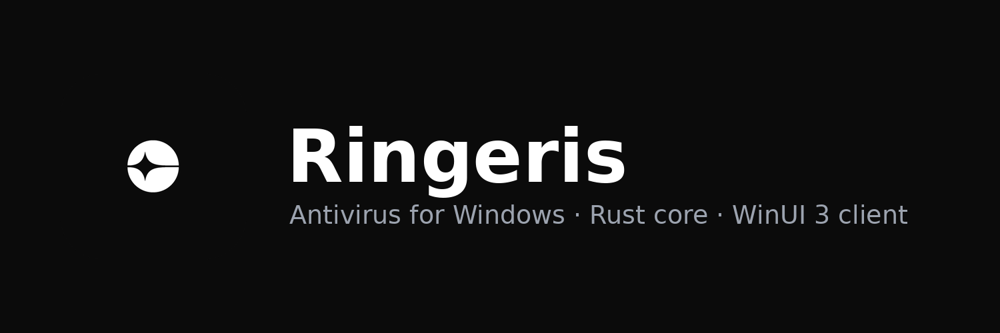

# Ringeris




Бесплатный антивирус с открытым кодом для Windows 10/11. Ядро написано на Rust, интерфейс — WinUI 3 с Fluent-дизайном. Сигнатуры берутся из открытых баз [ClamAV](https://www.clamav.net/) — тех самых, которыми двадцать лет пользуются почтовые серверы и Linux-шлюзы.

## Что умеет версия 0.2

- **Хеш-сигнатуры** — MD5 и SHA256 из `.hdb`/`.hsb`, как и раньше.
- **Байтовые паттерны** — сигнатуры `.ndb` с джокерами: `??` на байт, `{N-M}` на пропуск произвольного числа байт. Паттерн может быть привязан к абсолютному смещению, к концу файла (`EOF-N`), к точке входа PE (`EP+N`, `EP-N`), к началу последней или любой секции (`SL+N`, `S5+N`).
- **Логические сигнатуры** — подмножество формата `.ldb`: выражения `&`, `|`, `!` со скобками и ограничением дистанции между частями (`0&1{10-20}`).
- **Секционные хеши PE** — `.mdb`/`.msb`: считаются MD5/SHA256 каждой секции исполняемого файла и сверяются с базой.
- **Белый список** — `.fp` читается, и файл, попавший в него, не детектится. Это же лечит ложные срабатывания без правки баз.
- **Определение типа файла** по магическим байтам: PE, ELF, OLE2, ZIP, GZ, CAB, 7z, RAR, PDF, HTML, текст. Паттерны с целевым типом применяются только к файлам этого типа.
- **Архивы** — ZIP, CAB, GZ и TAR распаковываются и проверяются вглубь до трёх уровней, 7z проверяется на верхнем уровне. Рост в 500 раз по объёму считается zip-бомбой, такой архив пропускается.
- **Многопоточность** — проверка раскладывается на все ядра (до восьми потоков).
- **Фоновая защита** — Загрузки, а по желанию TEMP и рабочий стол; найденное уезжает в карантин автоматически.
- **Расписание** — ежедневная быстрая проверка в заданное время, пока приложение запущено.
- **Исключения** — пути-подстроки, которые не проверяются никогда.
- **Русский и английский интерфейс.**

## Чего нет — честно

- Из сигнатур ClamAV читаются `.hdb`, `.hsb`, `.fp`, `.ndb`, `.ldb`, `.mdb`, `.msb`. Остальное — bytecode, PCRE-части `.ldb`, `.yara`, `.imp` (хеши таблиц импорта), `.crb` сертификаты, макросы `$` в логических сигнатурах, группы `(i|g)` в паттернах — пропускается при загрузке. Паттернов в daily/main это затрагивает меньшинство, но зазор между Ringeris и clamscan реальный и большой.
- Сигнатуры с целевыми типами MAIL, MACH-O, FLASH, JAVA не совпадают никогда — такие типы ядро не определяет.
- RAR читается только как тип файла: проверяется сам архив, но не его содержимое. Нормального распаковщика RAR под лицензией, совместимой с GPL, в чистом Rust нет.
- Настоящий рантайм-щит на всю систему требует минифильтр-драйвера с подписью. Fallback — файловый монитор `notify` по избранным папкам.
- Эвристики нет: файл, которого нет в базе, будет «чистым». Ringeris не заменяет Microsoft Defender и не претендует. Defender оставьте включённым.

## Как устроено ядро

Ядро (`ringeris-core`) — консольный процесс, который читает контейнеры ClamAV `.cvd`/`.cld`: 512 байт текстового заголовка, дальше gzip-поток с tar-архивом или ZIP, из которого берутся файлы сигнатур. Формат разобран без libclamav — сборка ядра это просто `cargo build`, без C-тулчейна.

Проверка одного файла: определяется тип, для PE разбираются заголовки (секции, точка входа), считаются MD5 и SHA256, файл сверяется с белым списком и хеш-базами, затем по буферу прогоняется автомат Ахо-Корасика из «фиксированных головок» паттернов, совпадения досматриваются целиком с учётом джокеров и смещений, у логических сигнатур считается выражение по совпавшим частям. Наружу идут JSON-строки в stdout, поэтому ядро можно звать из скриптов и планировщика без GUI.

## Сборка

Ядро — любой компьютер с Rust:

```
cd core
cargo build --release
cargo test --release
```

Интерфейс — Windows 10/11 с .NET 8 SDK и рабочей нагрузкой .NET Desktop Development (WinUI 3):

```
dotnet publish app/Ringeris.App/Ringeris.App.csproj -c Release -p:Platform=x64 -p:RuntimeIdentifier=win-x64 -o publish/app
```

Рядом с `Ringeris.exe` нужен `ringeris-core.exe` — он ищется рядом или в `C:\Program Files\Ringeris\core`.

Установщик собирается через [Inno Setup 6](https://jrsoftware.org/isinfo.php):

```
iscc installer\ringeris.iss /DAppRoot=publish\app /DCoreExe=core\target\release\ringeris-core.exe
```

## Публикация репозитория

Скрипт `scripts/publish.ps1` создаёт репозиторий на GitHub и пушит текущую историю. Нужен только авторизованный `gh`, токен нигде не хранится:

```
gh auth login
.\scripts\publish.ps1
```

## Лицензия

GPL-3.0. ClamAV и его базы — собственность Cisco Talos и распространяются под GPL, спасибо им за это.
